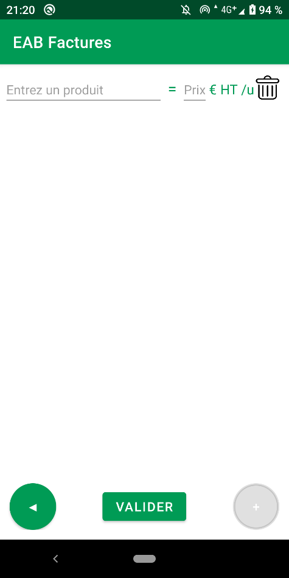
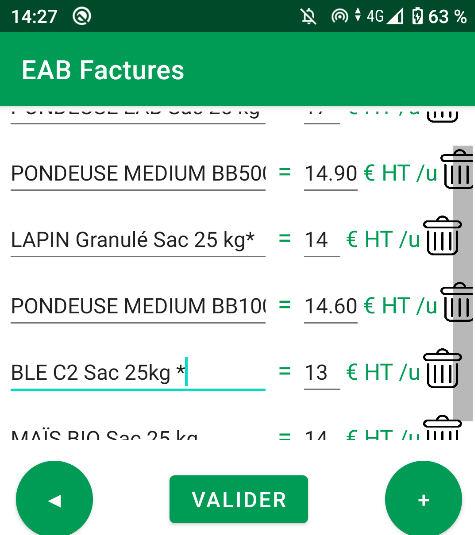
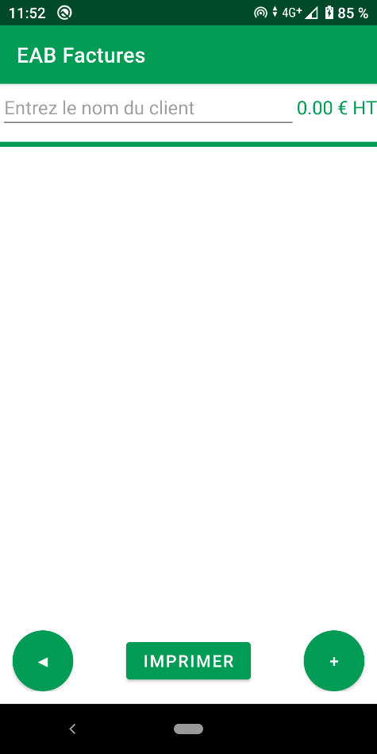
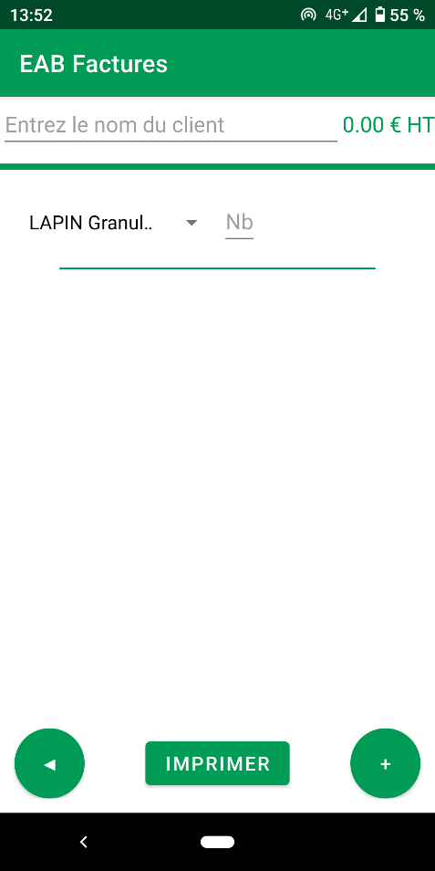
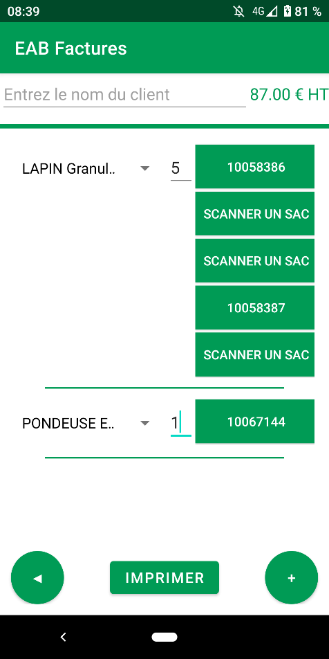

# Presentation of the project

This mobile application is used to create invoices for products orders. First you can add products in your catalog with the price per unit (without taxes). When you want to create a new invoice, you select the product and the quantity. Then you have to scan the barcode of each unit to get the unique number of each unit. When you are finished, you have a button which save the PDF invoice in your Google Drive account. You can combine this with another automation to automatically print the invoice when it is created.

**Catalog where you can add your products**

**Example of a catalog**

**New empty invoice**

**Select a product then the quantity**

**Scan the barcode of each unit the extract the unique identifiant**

